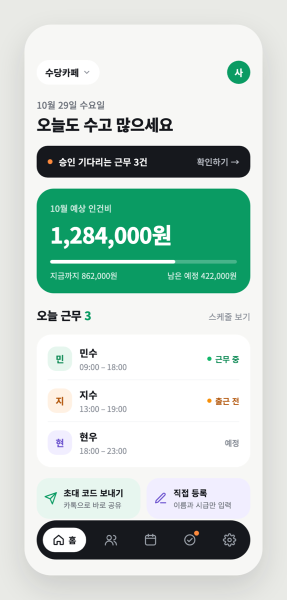
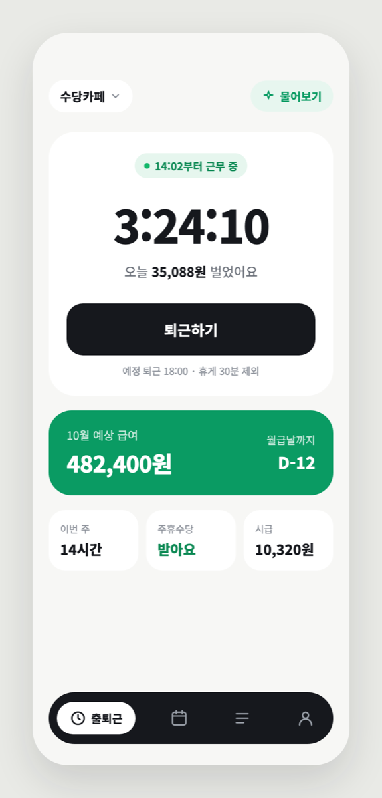
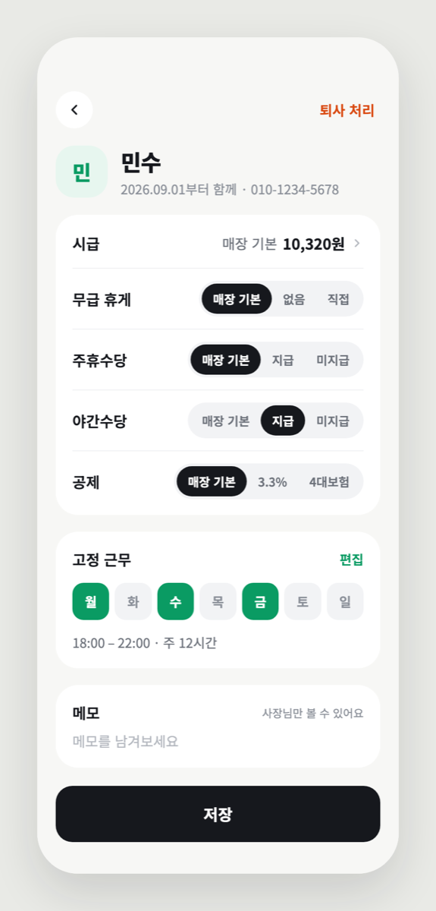
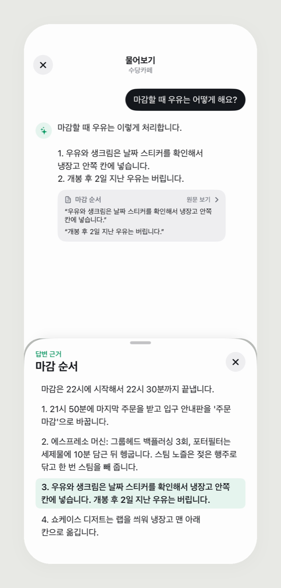
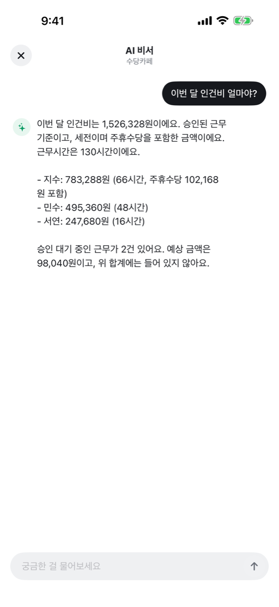
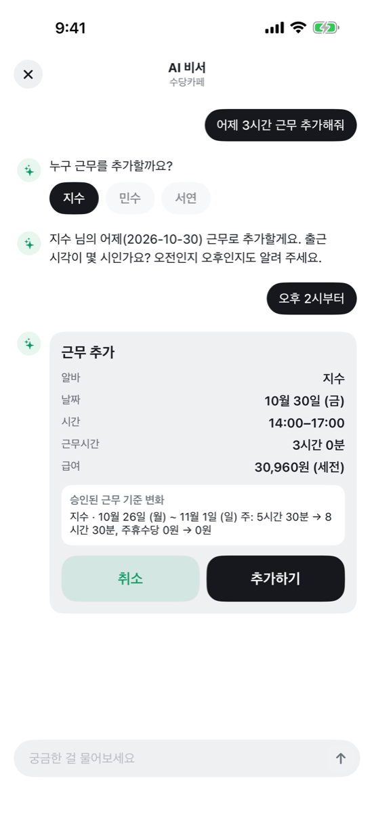
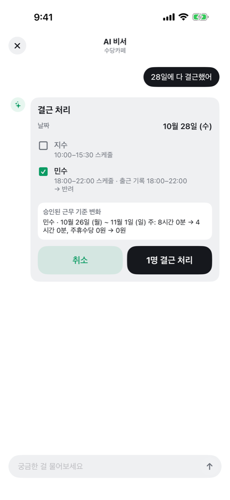
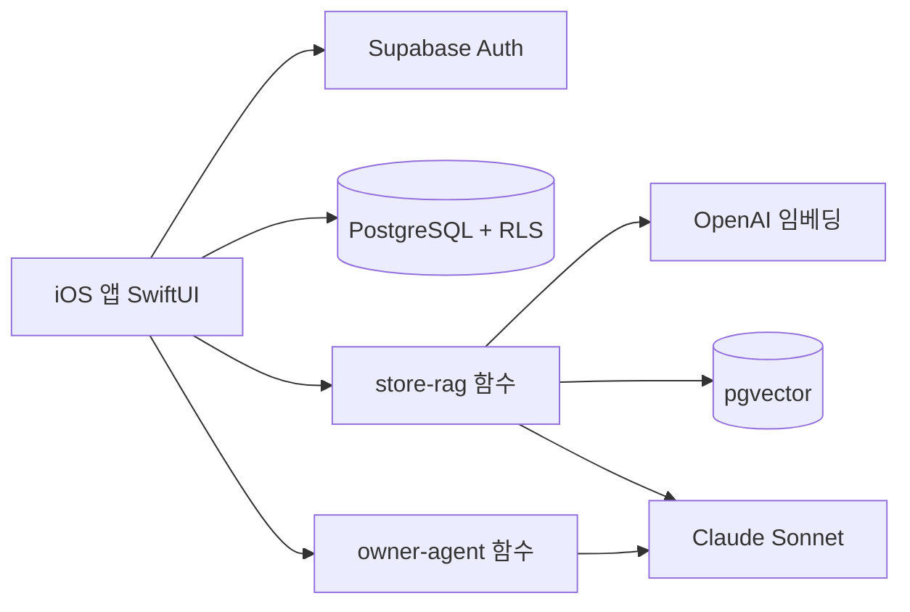

# 수당수당

사장님과 알바생이 **같은 근무 기록 하나**로 출퇴근, 승인, 예상 급여까지 확인하는 iOS 앱입니다.

- 매장 문서를 근거로 답하는 **알바생용 챗봇**
- 말로 묻고 확인 후 저장하는 **사장님 AI 비서**

[App Store에서 보기](https://apps.apple.com/kr/app/id6758724381) · 개인 프로젝트 · 2026.02 ~ 현재

| 사장님 홈 | 알바 출퇴근 | 직원별 급여 설정 | 매장 챗봇 |
|---|---|---|---|
|  |  |  |  |

## 왜 만들었나

- **기록이 흩어져 있습니다.** 출퇴근은 종이나 카카오톡에, 근무 변경은 단톡방에 남아서 월말에 다시 모아야 합니다.
- **급여를 두 번 계산합니다.** 사장님과 알바생이 각자 계산하다 보니 숫자가 다르면 어느 쪽이 맞는지 확인하기 어렵습니다.
- **매장마다 운영 방식이 다릅니다.** 마감 순서 같은 규칙을 알바생이 바뀔 때마다 다시 알려 줘야 합니다.

## 주요 기능

**알바생**
- 매장 코드(6자리)로 합류하고, 출근·퇴근 버튼으로 근무 기록
- 잠금화면에서 근무 시간 확인 (Live Activity)
- 달력에서 승인 상태와 이번 달 예상 급여(세전·세후) 확인
- 매장 공지·매뉴얼 열람, 모르는 건 챗봇에 질문

**사장님**
- 근무 승인·반려, 월별 인건비 확인
- 매장 기본값(시급, 야간·주휴수당, 휴게, 공제)을 정하고 직원별로 다르게 설정
- 고정 근무 요일·시간을 정하면 달력에 일정 자동 표시
- 공지·매뉴얼 등록 → 바로 챗봇의 근거가 됨
- AI 비서에게 말로 묻고, 근무 추가·승인·결근 처리

## 사장님 AI 비서

메뉴를 찾아 들어가지 않고 **물어보고 바로 답을 듣게** 만든 기능입니다.

> 물어보는 건 바로 답하고, 바꾸는 건 사장님이 확인해야 저장합니다.

| 조회 | 직원 고르기 | 결근 처리 | 급여 설정 변경 |
|---|---|---|---|
|  |  |  |  |
| "이번 달 인건비 얼마야?" | 누구인지 이름 버튼으로 고름 | 사람마다 체크, 체크한 사람만 저장 | 언제부터 적용할지 버튼으로 고름 |

**AI가 바로 저장하지 못하게 했습니다**

1. AI가 "근무를 추가하자"고 판단해도 앱은 저장하지 않고 **확인 카드**만 띄웁니다.
2. 직원·날짜·시각 중 하나라도 비면 카드를 만들지 않고 다시 묻습니다.
3. 카드에는 무엇이 바뀌는지와 그 결과 **주휴수당·금액 변화**를 계산해 보여 줍니다.
4. 사장님이 버튼을 눌러야 저장되고, AI는 실제로 저장된 것만 말합니다.

**AI가 쓸 수 있는 기능은 미리 정해 둔 13가지뿐입니다**

- 바로 하는 조회 6가지 — 직원 목록, 이번 달 급여, 주휴수당 조건, 승인 대기 근무, 근무 기록, 스케줄
- 버튼으로 묻기 2가지 — 직원 고르기, 정해진 답 고르기. 답이 정해진 질문은 일일이 입력하지 않게 버튼으로 묻습니다.
- 확인을 거쳐야 하는 저장 5가지 — 근무 추가, 근무 시간 수정, 승인·반려, 결근 처리, 급여 설정 변경

삭제, 공제 변경, 지난달 이전 근무 수정은 열어 두지 않았습니다.

**구조** — Claude Sonnet이 어떤 기능을 쓸지 고르고(tool use), 실제 실행은 앱이 합니다. 금액은 앱 화면과 같은 급여 계산 코드로 계산하므로, AI가 말하는 금액과 화면의 금액이 같습니다. 서버 함수(`owner-agent`)는 요청한 사람이 그 매장 사장님인지 확인하고 Claude 호출만 대신합니다.

## 매장 문서 챗봇 (RAG)

범용 AI는 우리 매장 규칙을 모르고, 모르면 그럴듯하게 지어냅니다. 그래서 **그 매장 문서 안에서만** 근거를 찾아 답하게 했습니다.

1. 사장님이 올린 문서를 줄 단위 조각으로 나눠 임베딩하고, 매장 ID와 함께 저장합니다.
2. 질문이 오면 그 매장 문서 안에서만 비슷한 문서 5개를 찾습니다.
3. Claude Sonnet이 그 문서만 보고 답하고, 답의 문장마다 근거가 된 문서 문장을 붙입니다.
4. 근거 문장이 하나도 없는 답은 보여 주지 않고 "찾지 못했어요"로 바꿉니다.
5. 알바생이 근거를 누르면 원문에서 그 문장이 강조되어 직접 확인할 수 있습니다.

**직접 만든 질문 30개로 확인한 결과** (답이 있는 질문 15개, 없는 질문 15개)

- 줄 단위 조각으로 바꾼 뒤 정답 문서가 1등인 경우가 10/15 → 12/15로 늘었습니다.
- 답이 있는 질문 15개는 모두 맞게 답했고, 답이 없는 질문 15개는 모두 "찾지 못했다"고 답했습니다.
- 다른 매장 문서는 조회·검색·챗봇 모두 0건이었습니다. DB 보안(RLS)과 검색 함수가 둘 다 매장 범위를 제한합니다.

질문 30개는 작은 세트라 경향을 본 정도이고, 실제 질문이 쌓이면 다시 측정할 예정입니다.

## 급여를 믿을 수 있게

- **시급을 바꿔도 지난 급여는 그대로입니다.** 근무가 저장되는 순간의 시급·야간수당·휴게 조건을 근무 기록에 함께 저장(스냅샷)합니다.
- **사장님과 알바생이 같은 계산 코드**를 씁니다. 그래서 두 화면의 금액이 같습니다.
- **휴게는 없음 / 법정 / 직접 입력 중에서 고릅니다.** 법정 휴게를 강제로 빼면 실제 매장 운영과 숫자가 어긋나서, 매장과 직원별로 고르게 했습니다.

## 구조



| 분야 | 기술 |
|---|---|
| iOS | Swift, SwiftUI, Swift Concurrency, ActivityKit |
| Backend | Supabase Auth, PostgreSQL, RLS, Edge Functions |
| AI | OpenAI text-embedding-3-small, pgvector, Claude Sonnet |

AI 키는 모두 서버 함수에만 두고, 앱에는 넣지 않습니다.

## 실행 방법

1. Xcode에서 `오늘얼마?/오늘얼마?.xcodeproj`를 엽니다.
2. `Config/Secrets.xcconfig`에 Supabase와 Kakao 로컬 설정을 넣습니다.
3. DB 마이그레이션과 서버 함수를 배포합니다.

```bash
supabase db push
supabase secrets set --env-file Config/.env
supabase functions deploy store-rag
supabase functions deploy owner-agent
```

## 더 보기

- [매장별 데이터 분리 (RLS)](docs/case-studies/multi-tenant-rls.md)
- [급여 신뢰성 개선](docs/case-studies/payroll-reliability.md)
- [한국 시간 기준 날짜 계산](docs/adr/0001-kst-time-boundary.md)
- [변경 이력](CHANGELOG.md)
